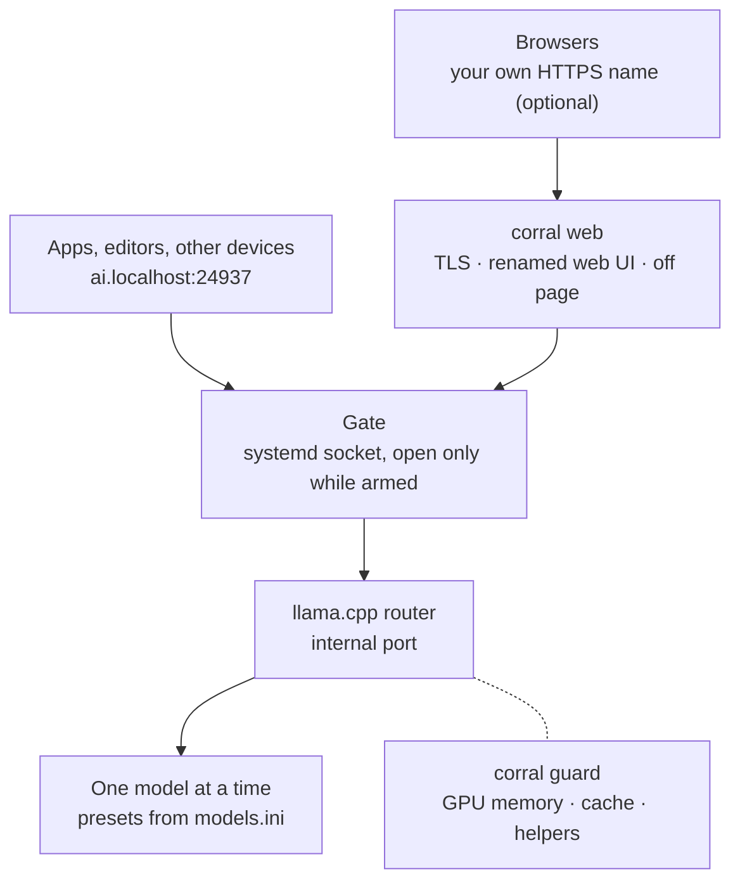

<div align="center">
  <h1 style="font-weight: 700; font-size: 4em; margin: 0; padding-top: 0;">Corral</h1>
  <p><i>A home on the range, where the llamas can play.</i></p>
  <div style="margin-bottom: 1em">
  <a href="https://github.com/sannidhyaroy/corral/blob/main/LICENSE"></a>
  <a href="https://github.com/sannidhyaroy/corral/issues"></a>
  <a href="https://github.com/sannidhyaroy/corral/commits/main"></a>
  </div>
  <p>Herd and serve your <a href="https://github.com/ggml-org/llama.cpp">llama.cpp</a> models, on demand and behind one gate.</p>
</div>

---

## **Navigation**
- [Status](#status)
- [Features](#features)
- [How it works](#how-it-works)
- [Requirements](#requirements)
- [Installation](#installation)
- [Usage](#usage)
- [Configuration](#configuration)
- [Security](#security)
- [Limitations](#limitations)
- [FAQ](#faq)
- [Get in touch](#get-in-touch)
- [License](#license)

---

## Status

> [!IMPORTANT]
> Corral is in early development. I use it daily, but for now installing it means building from source and copying files by hand. A proper `corral install` is on its way.

---

## Features

### On demand
- [x] Off unless armed: `corral on` opens the gate, `corral off` closes it, and nothing is enabled at boot
- [x] Models start on the first request and stop after being idle, so memory is free whenever you aren't using them
- [x] One model at a time, switched automatically when an app asks for another one

### One gate
- [x] One address for every app: OpenAI-compatible API, Anthropic Messages API and llama.cpp's own endpoints
- [x] llama.cpp's web UI at `http://ai.localhost:24937`, renamed to Corral
- [x] Your own name with HTTPS, with a friendly page and an **Open the gate** button while Corral is off
- [x] Reachable from your own devices on the networks you allow in the firewall
- [ ] Bring your own certificate or CA for that name, or let Corral create one
- [ ] API keys for other devices, created and revoked with `corral key`
- [ ] One process for every door, answering "Corral is off" instead of refusing connections

### Presets
- [x] Every model and its settings as a named preset in one `models.ini` (context size, speculative decoding, sampling, thinking on or off)
- [ ] **Corral · Auto**: a virtual model that answers with whatever is loaded, for side jobs like chat titles
- [ ] Thinking controls that mean the same thing on every model

### Guard
- [x] Watches GPU memory and unloads a model before the GPU runs out (AMD GPUs for now)
- [x] Frees cached model files when models switch, so the next one loads cleanly
- [x] Presets that need the whole GPU stop smaller helpers (like an edit-prediction model) while they run

### Housekeeping
- [x] `corral status`: what is armed, what is loaded, GPU memory, temperatures and power
- [ ] `corral install` and `corral uninstall`, including upgrades, with nothing hardcoded for one machine
- [ ] `corral pull`: download GGUFs from Hugging Face with pause, resume and retry, straight into a preset

---

## How it works



systemd holds every port. Programs start when the first request arrives and exit when idle, so an armed Corral that nobody uses costs nothing but a few open sockets.

---

## Requirements

- Linux with systemd
- [llama.cpp](https://github.com/ggml-org/llama.cpp)'s `llama-server` with router support (`--models-preset`)
- A Rust toolchain to build Corral
- Some GGUF models, and a working brain 🧠 to pick the presets

---

## Installation

> [!NOTE]
> Until `corral install` exists, installation is manual and the steps below will change.

- Clone this repo:

  ```bash
  git clone git@github.com:sannidhyaroy/corral.git Corral && cd Corral
  ```
  <details><summary>Clone using HTTPS? 👀</summary>

  Run this command, instead of the above one:
    ```bash
    git clone https://github.com/sannidhyaroy/corral.git Corral && cd Corral
    ```

  </details>

- Build:

  ```bash
  cargo build --release
  ```

---

## Usage

| Command | What it does |
|---|---|
| `corral on` | Arm: open the gate. Servers start on their first request and stop after idle |
| `corral off` | Disarm: close the gate and stop anything running |
| `corral status`, `corral st` | Armed or not, what is running, which model is loaded, GPU memory, temperatures (also plain `corral`) |
| `corral logs`, `corral lg` | Follow the servers' logs |
| `corral help`, `-h`, `--help` | The same list, from the command line |

Point any OpenAI-compatible app at `http://ai.localhost:24937/v1` and pick a preset by its name.

---

## Configuration

| File | What it holds |
|---|---|
| `~/.config/corral/models.ini` | The presets: one section per model and its llama.cpp settings |
| `~/.config/corral/corral.conf` | Corral's own settings: helpers, presets that need the whole GPU, the guard's limits |
| `~/.config/corral/ui.json` | Default web UI settings for browsers that have none saved yet |

---

## Security

- Requests from the machine itself are trusted. Other devices reach Corral only on the networks you open in the firewall.
- llama.cpp's built-in tools (`--tools`) run on the machine that serves them, whichever device asks. Until API keys exist, enable them only if you trust everyone on the networks you opened.
- The web UI defaults (`ui.json`) are sent to every visitor, so they must never contain API keys.

> [!CAUTION]
> If you give Corral your own name, pick one you control or a reserved one (`.internal`, `.home.arpa`). A real public domain only reaches your machine through your local overrides (`/etc/hosts`, your own DNS). A device that skips them, for example with a public Private DNS or Secure DNS provider, sends its requests and chats to whoever owns that domain.

---

## Limitations

- Linux with systemd only. Corral leans on systemd for every port and every start and stop.
- The guard reads GPU memory the way AMD reports it on Linux. On NVIDIA or Intel GPUs, Corral works, but the guard can't watch memory yet.

---

## FAQ

### Why not just run `llama-server`?

You can, and Corral does exactly that underneath. Corral adds what a single server doesn't: nothing running until it's needed, one address for every model, a guard against running out of GPU memory, and a web UI that tells you when the gate is closed.

### Why is it off after every reboot?

Because a machine that isn't serving models shouldn't hold their memory. `corral on` takes a second, and nothing loads until something asks.

### Why "Corral"?

It's where you keep your llamas.

### Why port 24937?

Write 24937 in hexadecimal and read it as two bytes: `0x61 0x69`. In ASCII, that's `ai`. The same trick gives the custom name its address, `127.0.97.105`, which reads `127.0.'a'.'i'`.

---

## Get in touch
To ask a question, offer suggestions or share an idea, please use the [discussions tab](https://github.com/sannidhyaroy/corral/discussions) of this repository.

If you spot any bugs or vulnerabilities, please [create an issue](https://github.com/sannidhyaroy/corral/issues/). It's always a good idea to make sure there aren't any similar issues open, before creating a new one!

---

## License

Corral is licensed under the [GNU Affero General Public License v3.0](https://github.com/sannidhyaroy/corral/blob/main/LICENSE).
