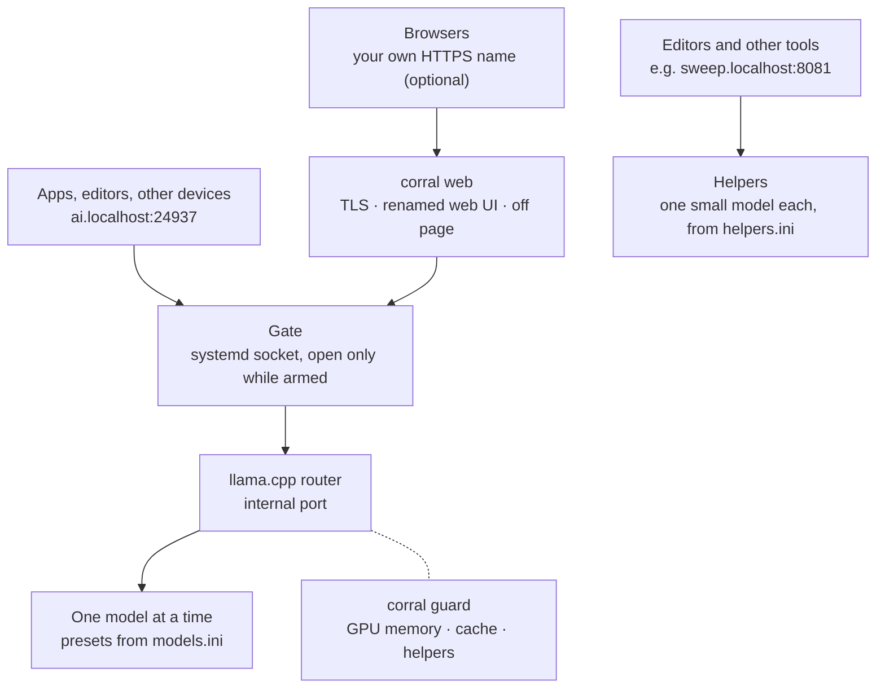

<div align="center">
  <h1 style="font-weight: 700; font-size: 4em; margin: 0; padding-top: 0;">Corral</h1>
  <p><i>A home on the range, where the llamas can play.</i></p>
  <div style="margin-bottom: 1em">
  <a href="https://github.com/sannidhyaroy/corral/blob/main/LICENSE"></a>
  <a href="https://github.com/sannidhyaroy/corral/issues"></a>
  <a href="https://github.com/sannidhyaroy/corral/commits/main"></a>
  </div>
  <p>Herd and serve your <a href="https://github.com/ggml-org/llama.cpp">llama.cpp</a> models, on demand and behind one gate.</p>
</div>

---

## **Navigation**
- [Status](#status)
- [Features](#features)
- [How it works](#how-it-works)
- [Requirements](#requirements)
- [Installation](#installation)
- [Usage](#usage)
- [Configuration](#configuration)
- [Helpers](#helpers)
- [Security](#security)
- [Limitations](#limitations)
- [FAQ](#faq)
- [Contributing](#contributing)
- [Get in touch](#get-in-touch)
- [Credits](#credits)
- [License](#license)

---

## Status

> [!IMPORTANT]
> Corral is in early development. I use it daily, and installing, upgrading and uninstalling are one command each, but expect things to change between versions.

---

## Features

### On demand
- [x] Off unless armed: `corral on` opens the gate, `corral off` closes it, and nothing is enabled at boot
- [x] Models start on the first request and stop after being idle, so memory is free whenever you aren't using them
- [x] One model at a time, switched automatically when an app asks for another one

### One gate
- [x] One address for every app: OpenAI-compatible API, Anthropic Messages API and llama.cpp's own endpoints
- [x] llama.cpp's web UI at `http://ai.localhost:24937`, renamed to Corral
- [x] Your own name with HTTPS, with a friendly page and an **Open the gate** button while Corral is off
- [x] Reachable from your own devices on the networks you allow, when you choose to
- [ ] Bring your own certificate or CA for that name, or let Corral create one
- [ ] API keys for other devices, created and revoked with `corral key`
- [ ] One process for every door, answering "Corral is off" instead of refusing connections

### Presets
- [x] Every model and its settings as a named preset in one `models.ini` (context size, speculative decoding, sampling, thinking on or off)
- [ ] **Corral · Auto**: a virtual model that answers with whatever is loaded, for side jobs like chat titles
- [ ] Thinking controls that mean the same thing on every model

### Helpers
- [x] Small models beside the router, each in its own server, for jobs that can't wait for a model swap (edit predictions, dictation, embeddings)
- [x] Armed with `corral on` when you want them, or once with `corral on --with <helper>`
- [x] They step aside for presets that need the whole GPU, and go first when GPU memory runs short
- [x] Any server, not just llama-server

### Guard
- [x] Watches GPU memory: a warning first, helpers stopped next, the model unloaded only as a last resort (AMD GPUs for now)
- [x] Frees cached model files when models switch, so the next one loads cleanly
- [x] Unloads the router's model when a helper that needs the whole GPU starts

### Command line
- [x] `corral status`: a llama whose face tells you Corral's state, bars for GPU memory and RAM, temperatures and power; plain text in pipes, `--json` for scripts
- [x] Shell completions for bash, zsh, fish, elvish and PowerShell
- [x] `corral install` and `corral uninstall`, including upgrades and backups, with nothing hardcoded for one machine
- [ ] `corral pull`: download GGUFs from Hugging Face with pause, resume and retry, straight into a preset

---

## How it works



systemd holds every port. Programs start when the first request arrives and exit when idle, so an armed Corral that nobody uses costs nothing but a few open sockets. Corral is one program: the command line, the guard (`corral guard`) and the web front (`corral web`) are the same binary.

---

## Requirements

- Linux with systemd
- [llama.cpp](https://github.com/ggml-org/llama.cpp)'s `llama-server` with router mode (`--models-preset`), on your `PATH`
- A [Rust](https://rustup.rs) toolchain to build Corral
- Some GGUF models, and a working brain 🧠 to pick the presets

---

## Installation

- Clone this repo:

  ```bash
  git clone git@github.com:sannidhyaroy/corral.git Corral && cd Corral
  ```
  <details><summary>Clone using HTTPS? 👀</summary>

  Run this command, instead of the above one:
    ```bash
    git clone https://github.com/sannidhyaroy/corral.git Corral && cd Corral
    ```

  </details>

- Build:

  ```bash
  cargo build --release
  ```

- See what installing would change, without changing anything:

  ```bash
  ./target/release/corral install --dry-run
  ```

- Install:

  ```bash
  ./target/release/corral install
  ```

  This copies Corral to `~/.local/bin/corral`, generates its systemd units from your settings, writes commented starter settings where you have none, and installs the bash completion. Files it replaces are backed up first, and your own settings are never overwritten. With a custom name, it also sets up the web front's system units and an `/etc/hosts` entry through `sudo`, showing each command first.

> [!NOTE]
> `~/.local/bin` must be on your `PATH`. Most distributions add it once the folder exists; if `corral` isn't found, open a new terminal or add it yourself.

- **Upgrade:** pull, build, and run `corral install` again. It says what changed, and that it's up to date when nothing did.

- **Uninstall:** `corral uninstall` removes everything Corral installed and tells you what it left behind: your settings, your certificate and the backups. `corral uninstall --purge` removes those too. Your model files are never touched.

---

## Usage

| Command | What it does |
|---|---|
| `corral on` | Arm: open the gate. Servers start on their first request and stop after idle |
| `corral on --with <helpers>`, `--without <helpers>` | Arm with or without some helpers this time (comma-separated) |
| `corral off` | Disarm: close the gate and stop everything, waiting until it has really stopped |
| `corral status`, `corral st`, or just `corral` | Armed or not, what is loaded, helpers, GPU memory, RAM, temperatures and power |
| `corral status --json` | The same, for scripts and status bars |
| `corral logs`, `corral lg` | Follow the logs of every Corral unit |
| `corral install`, `--dry-run` | Install or upgrade; with `--dry-run`, only show what would change |
| `corral uninstall`, `--purge` | Remove Corral; with `--purge`, your settings and backups too |
| `corral completions <shell>` | Print the completion script for bash, zsh, fish, elvish or PowerShell |
| `corral help`, `-h`, `--help` | The same list, from the command line |

Point any OpenAI-compatible app at `http://ai.localhost:24937/v1` and pick a preset by its name.

---

## Configuration

Everything lives in `~/.config/corral/` (or `$XDG_CONFIG_HOME/corral/`):

| File | What it holds |
|---|---|
| `corral.conf` | Corral's own settings (below) |
| `models.ini` | The presets the router serves: one section per model, with llama-server options as keys |
| `helpers.ini` | The [helpers](#helpers) |
| `ui.json` | Default web UI settings for browsers that have none saved yet (optional) |
| `tls/` | `fullchain.pem` and `privkey.pem` for your custom name (optional) |

The settings in `corral.conf`, one `key = value` per line:

| Setting | Default | What it does |
|---|---|---|
| `gate_port` | `24937` | Where apps reach Corral |
| `router_port` | `18080` | Where llama.cpp's router listens, on this machine only |
| `listen` | `local` | `all` lets every network your firewall allows reach the gate |
| `models_max` | `1` | How many models the router keeps loaded at once |
| `router_options` | | Extra llama-server options for the router (`llama-server --help` lists them all) |
| `exclusive` | | Presets that need the whole GPU; helpers step aside while one loads |
| `gpu_warn`, `gpu_unload` | 90%, 95% | The guard's GPU memory limits in GiB |
| `name` | | Your own HTTPS name for the web UI |
| `name_address` | `127.0.97.105` | The local address that name points to |

> [!IMPORTANT]
> After changing ports, `listen`, `name`, `models_max`, `router_options` or `helpers.ini`, run `corral install` again, so the systemd units match your settings.

---

## Helpers

The router keeps one model loaded and swaps models on demand. Some jobs can't wait for a swap, and shouldn't push your chat model out of memory either: edit predictions on almost every keystroke, dictation, embeddings. Helpers are small models that run beside the router, each in its own server, started on demand and stopped when idle like everything else.

```ini
# ~/.config/corral/helpers.ini
[edits]
model = ~/Models/edit-model.gguf   # llama-server options, exactly as in models.ini
ctx-size = 8192
port = 8081                        # where your editor reaches it: http://edits.localhost:8081
armed = no                         # plain `corral on` leaves it out; `corral on --with edits` adds it

[speech]
type = custom                      # any other server; {port} is filled in by Corral
command = whisper-server --model ~/Models/ggml-large-v3-turbo.bin --host 127.0.0.1 --port {port}
port = 8082
```

| Key | What it does |
|---|---|
| `type` | `llama` (default): llama-server, with the other keys as its options. `custom`: runs `command` |
| `port` | Where clients reach it; the server itself listens on `port` + 10000 unless you set `internal-port` |
| `armed` | `yes`: plain `corral on` includes it |
| `yields` | `yes` (default): steps aside for presets that need the whole GPU, and goes first when GPU memory runs short |
| `claims` | `gpu`: the router's model is unloaded when this helper starts |

---

## Security

- By default, only this machine can reach the gate. With `listen = all`, every network your firewall allows can, and there are no API keys yet: anyone on those networks can use your models.
- llama.cpp's built-in tools (`--tools` in `router_options`) run on the machine that serves them, whichever device asks. Enable them only if you trust everyone who can reach the gate.
- The web UI defaults (`ui.json`) are sent to every visitor, so they must never contain API keys.
- With a custom name, `corral install` adds one line to `/etc/hosts`, marked `# Corral`, and only ever appends. Corral never removes lines from that file: `corral uninstall` tells you which line to remove yourself.

> [!CAUTION]
> If you give Corral your own name, pick one you control or a reserved one (`.internal`, `.home.arpa`). A real public domain only reaches your machine through your local overrides (`/etc/hosts`, your own DNS). A device that skips them, for example with a public Private DNS or Secure DNS provider, sends its requests and chats to whoever owns that domain.

---

## Limitations

- Linux with systemd only. Corral leans on systemd for every port and every start and stop.
- The guard reads GPU memory the way AMD reports it on Linux. On NVIDIA or Intel GPUs, Corral works, but the guard can't watch memory yet.
- The custom name needs a certificate you bring yourself, for now.

---

## FAQ

### Why not just run `llama-server`?

You can, and Corral does exactly that underneath. Corral adds what a single server doesn't: nothing running until it's needed, one address for every model, helpers beside the main model, a guard against running out of GPU memory, and a web UI that tells you when the gate is closed.

### Why is it off after every reboot?

Because a machine that isn't serving models shouldn't hold their memory. `corral on` takes a moment, and nothing loads until something asks.

### Where are my backups?

In `~/.local/share/corral/backups/`, one folder per install or uninstall, named by date and time. Each file sits under its original path, so restoring one is a copy back.

### Why "Corral"?

It's where you keep your llamas.

### Why port 24937?

Write 24937 in hexadecimal and read it as two bytes: `0x61 0x69`. In ASCII, that's `ai`. The same trick gives the custom name its address, `127.0.97.105`, which reads `127.0.'a'.'i'`.

---

## Contributing

- Install [Rust](https://rustup.rs) and the [uv](https://docs.astral.sh/uv/) project manager by [Astral](https://astral.sh/).
- Clone this repo, then set up the git hooks once:

  ```bash
  uv run prek install
  ```

  This installs [prek](https://github.com/j178/prek), pinned in `uv.lock`, inside the project rather than globally, and wires it into `.git/hooks/`. Before each commit, `cargo fmt` and `cargo clippy` check exactly what you staged, and the commit message is checked too.

- Commits follow [Conventional Commits](https://www.conventionalcommits.org/) with a scope, like `feat(cli): add shell completions`, and titles of at most 72 characters. Fixes to commits that aren't pushed yet go in as `git commit --fixup=<commit>`, so they fold in with `git rebase -i --autosquash`.

> [!NOTE]
> Hooks live in `.git/`, which is never cloned, so `uv run prek install` is needed once in every clone.

---

## Get in touch
To ask a question, offer suggestions or share an idea, please use the [discussions tab](https://github.com/sannidhyaroy/corral/discussions) of this repository.

If you spot any bugs or vulnerabilities, please [create an issue](https://github.com/sannidhyaroy/corral/issues/). It's always a good idea to make sure there aren't any similar issues open, before creating a new one!

---

## Credits

Corral serves your models through [llama.cpp](https://github.com/ggml-org/llama.cpp), and while Corral is off, its page shows llama.cpp's icon, so the tab looks the same either way. llama.cpp and its icon are licensed under the MIT License.

---

## License

Corral is licensed under the [GNU Affero General Public License v3.0](https://github.com/sannidhyaroy/corral/blob/main/LICENSE).
